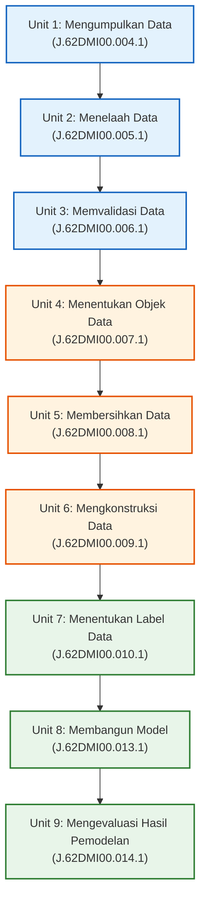

# Panduan Alur Kerja dan Dokumentasi Proyek Sertifikasi Data Science
## Pengelompokan (Clustering) Negara di Dunia Menggunakan K-Means Berdasarkan Profil Demografi
### Berdasarkan Standar Kompetensi Kerja Nasional Indonesia (SKKNI 299-2020)

---

### Informasi Skema Asesmen & Sertifikasi
* **Jenis Skema:** Okupasi
* **Judul Skema:** Associate Data Scientist
* **Nomor Skema:** SSK22/BPPMPVKPTK/KKRPL/2022
* **Tujuan Asesmen:** Sertifikasi Kompetensi Keahlian Data Science
* **Standar Kompetensi Acuan:** SKKNI No. 299 Tahun 2020
* **Judul Proyek:** Analisis Pengelompokan Negara Berdasarkan Profil Demografi Dunia Menggunakan Algoritma Unsupervised K-Means Clustering
* **Dataset:** `world_population.csv` (234 negara/wilayah teritori, 17 variabel demografi)
* **File Utama Koding:** `analisis_kmeans.ipynb`
* **Folder Output:** `output/` (15 grafik 300 DPI, 2 model `.pkl`, 1 dataset terklaster `.csv`)
* **Laporan Resmi:** `laporan/` (`.docx` dan `.pdf`)
* **Dashboard Interaktif:** `index.html` (Simulator K-Means live autocomplete 234 negara)

---

## 1. Peta Jalan Pengerjaan (9 Unit Kompetensi SKKNI 299-2020)

Alur kerja dirancang berurutan dari hulu ke hilir mengacu secara ketat pada 9 Unit Kompetensi Skema Okupasi Associate Data Scientist:

---

## 2. Rangkuman Temuan Data (Penjelasan untuk Orang Awam)

Sebelum data diproses oleh model machine learning, data telah diaudit dan divalidasi secara mendalam:

| Pemeriksaan | Hasil Temuan | Penjelasan Ramah Awam (Arti Temuan) |
| :--- | :---: | :--- |
| **Data Kosong (NaN / Null)** | **0 (Tidak Ada)** | **Sangat Baik.** Semua kotak data terisi lengkap 100%. Tidak ada data hilang sehingga **tidak perlu dilakukan pengisian/imputasi mean/median**. |
| **Data Duplikat** | **0 (Tidak Ada)** | **Sangat Baik.** Tidak ada nama negara atau baris yang tercatat ganda. |
| **Nilai 0 (Zero Values)** | **57 Negara** | Nilai 0 **hanya ada pada kolom `World Population Percentage`**. Pada populasi, luas wilayah, dan kepadatan **tidak ada angka 0**. 💡 *Artinya:* Negara-negara mikro (seperti Vatikan, Samoa, Niue, Monaco) memiliki penduduk di bawah 400.000 jiwa. Proporsinya terhadap penduduk bumi (< 0,005%) secara otomatis dibulatkan menjadi `0.00%`. Ini **bukan error**, melainkan keterbatasan jumlah desimal. |
| **Bentuk Sebaran (*Skewness*)** | **Menceng Ekstrem (Right-Skewed > +6)** | **Data Tidak Merata.** Mayoritas negara berpenduduk dan berwilayah sedang/kecil, tetapi ada segelintir "raksasa" seperti China, India (populasi > 1,4 miliar), dan Rusia (wilayah amat luas). 💡 *Analogi:* Seperti menimbang semut dan gajah dalam satu timbangan yang sama. Di Unit 5, data dinormalkan melalui **Transformasi Logaritma Natural (`np.log1p`)** dengan prinsip *Zero Data Loss* (tanpa membuang negara raksasa). |
| **Hubungan Antar Data (*Korelasi*)** | **Korelasi Historis 1.0 (Identik)** | Populasi negara dari tahun 1970 sampai 2022 polanya kembar identik ($r \ge 0.98$ hingga $1.00$). 💡 *Artinya:* Kita tidak perlu memasukkan semua tahun (1970, 1980, 1990, dst.) ke K-Means untuk menghindari pembobotan bias 73%. Cukup gunakan **Populasi 2022** bersama Luas Wilayah, Kepadatan, dan Laju Pertumbuhan. |

---

## 3. Checklist Tugas Pengerjaan Berdasarkan 9 Unit Kompetensi SKKNI

> **Keterangan Status:**  
> `[x]` = **Selesai Dikerjakan & Diverifikasi** (Koding aktif, output visual dan tabular telah tersaji lengkap di notebook)

---

### UNIT KOMPETENSI 1: MENGUMPULKAN DATA (`J.62DMI00.004.1`)
- [x] **Task 1.1 — Identifikasi Sumber Data:** Menetapkan sumber data sekunder dari Kaggle Public Dataset (*World Population Dataset* oleh UN DESA).
- [x] **Task 1.2 — Penyiapan Lingkungan & Library:** Mengimpor modul pengolah data, komputasi numerik, dan visualisasi (`numpy`, `pandas`, `matplotlib`, `seaborn`, `pathlib`).
- [x] **Task 1.3 — Konfigurasi Jalur Folder Dinamis:** Menetapkan jalur `BASE_DIR`, `DATA_PATH`, dan `OUTPUT_DIR` menggunakan pustaka `pathlib.Path`.
- [x] **Task 1.4 — Pemuatan Dataset ke Memori:** Membaca berkas `world_population.csv` ke dalam DataFrame `df` dan memverifikasi sampel awal (`head`) dan dimensi data (234 baris $\times$ 17 kolom).

---

### UNIT KOMPETENSI 2: MENELAAH DATA (`J.62DMI00.005.1`)
- [x] **Task 2.1 — Telaah Daftar Kolom & Metadata:** Memeriksa seluruh 17 atribut dataset dan menyusun tabel kamus data operasional.
- [x] **Task 2.2 — Telaah Struktur Teknis & Memori:** Menjalankan `df.info()` untuk mengevaluasi alokasi memori dan integritas kolom.
- [x] **Task 2.3 — Telaah Tipe Data:** Menjalankan `df.dtypes` untuk memisahkan fitur teks kategorikal (`object`) dengan fitur numerik (`int64`, `float64`).
- [x] **Task 2.4 — Analisis Statistik Deskriptif (`df.describe`):** Menghitung ringkasan ukuran pemusatan (*mean*, *median*) dan penyebaran (*std*, *min*, *max*, kuartil).
- [x] **Task 2.5 — Panduan Membaca Statistik Deskriptif Ramah Awam:** Menyusun narasi edukatif mengenai perbedaan mean vs median dan disparitas ekstrem angka demografi global.
- [x] **Task 2.6 — Telaah Sebaran Geografis Awal:** Memeriksa distribusi kategori benua (`df['Continent'].value_counts()`) yang mencakup 6 benua utama.

---

### UNIT KOMPETENSI 3: MEMVALIDASI DATA (`J.62DMI00.006.1`)
- [x] **Task 3.1 — Validasi Kelengkapan Data:** Menjalankan `df.isnull().sum()` dan membuktikan nilai missing value bernilai 0 di seluruh 17 kolom.
- [x] **Task 3.2 — Validasi Keunikan Baris Data:** Menjalankan `df.duplicated().sum()` dan membuktikan tidak ada data ganda (0 duplikat).
- [x] **Task 3.3 — Validasi Integritas Atribut Khusus (0.00%):** Membuktikan secara matematis bahwa angka `0.00%` pada 57 negara mikro (seperti Vatikan, Niue, Tokelau, Monaco) adalah pembulatan sah dan bukan nilai hilang.
- [x] **Task 3.4 — Konfirmasi Tanpa Imputasi:** Memvalidasi bahwa dataset 100% lengkap sehingga tidak memerlukan imputasi mean atau median.

---

### UNIT KOMPETENSI 4: MENENTUKAN OBJEK DATA (`J.62DMI00.007.1`)
- [x] **Task 4.1 — Identifikasi Objek Pengamatan:** Menetapkan objek analisis adalah 234 negara dan wilayah teritori berdaulat dunia.
- [x] **Task 4.2 — Eksplorasi Bentuk Distribusi & Skewness:** Menghitung koefisien kemencengan kurva (`df.skew()`) dan menyimpan visualisasi histogram/boxplot mentah di `output/eda_distribusi_sebelum_transformasi.png`.
- [x] **Task 4.3 — Uji Multikolinearitas Antar Variabel Historis:** Menghitung matriks korelasi Pearson dan membuat grafik 2x2 scatter plot regresi di `output/eda_scatter_korelasi.png`, membuktikan populasi 1970-2022 berkorelasi sempurna ($r=1.00$).
- [x] **Task 4.4 — Seleksi 4 Pilar Fitur Kunci (*Feature Selection*):** Mengeliminasi 7 fitur populasi historis guna mencegah bias bobot 73%, serta memilih 4 fitur independen:
  1. `2022 Population` (Ukuran populasi terkini)
  2. `Area (km²)` (Luas bentang daratan)
  3. `Density (per km²)` (Tingkat kepadatan ruang hunian)
  4. `Growth Rate` (Dinamika laju pertumbuhan)
- [x] **Task 4.5 — Visualisasi Fitur Terpilih:** Membuat visualisasi peringkat Top 10 negara di `output/eda_top10_fitur_terpilih.png` dan matriks pairplot di `output/eda_pairplot_fitur_terpilih.png`.

---

### UNIT KOMPETENSI 5: MEMBERSIHKAN DATA (`J.62DMI00.008.1`)
- [x] **Task 5.1 — Analisis Outlier & Prinsip Zero Data Loss:** Menetapkan bahwa pencilan kependudukan (China, India, Rusia) tidak boleh dihapus demi mempertahankan integritas populasi bumi.
- [x] **Task 5.2 — Transformasi Logaritma Natural (`np.log1p`):** Mengaplikasikan fungsi $y = \ln(x + 1)$ pada fitur bernilai besar guna meredam rentang data masif dan menormalkan kemencengan ekstrem:
  * Populasi: $+9.15 \rightarrow -0.60$
  * Luas Wilayah: $+6.08 \rightarrow -0.68$
  * Kepadatan: $+8.95 \rightarrow +0.17$
- [x] **Task 5.3 — Validasi Visual Sebelum vs Sesudah:** Menyimpan dashboard perbandingan 3x4 *Side-by-Side* di `output/perbandingan_sebelum_sesudah_preprocessing.png`.

---

### UNIT KOMPETENSI 6: MENGKONSTRUKSI DATA (`J.62DMI00.009.1`)
- [x] **Task 6.1 — Rekayasa Fitur (*Feature Engineering*):** Menyatukan 3 fitur bertransformasi logaritma dengan fitur laju pertumbuhan rasio ke dalam matriks kerja `df_log`.
- [x] **Task 6.2 — Standardisasi Skala Z-Score (`StandardScaler`):** Mentransformasikan data agar memiliki rata-rata $\mu = 0$ dan standar deviasi $\sigma = 1$ menggunakan rumus $z = \frac{x - \mu}{\sigma}$.
- [x] **Task 6.3 — Penyetaraan Bobot Jarak Euclidean:** Menghilangkan dominasi satuan unit, sehingga setiap fitur memberikan kontribusi bobot seimbang 25% bagi algoritma K-Means.
- [x] **Task 6.4 — Visualisasi Distribusi Skala Standar:** Menyimpan visualisasi boxplot fitur terstandarisasi di `output/eda_standardized_features.png`.

---

### UNIT KOMPETENSI 7: MENENTUKAN LABEL DATA (`J.62DMI00.010.1`)
- [x] **Task 7.1 — Eksperimen Elbow Method (Inersia WCSS):** Menghitung penurunan variasi jarak dalam klaster untuk $K=1$ hingga $K=10$, serta menyimpan visualisasi patahan siku di `output/model_elbow_method.png`.
- [x] **Task 7.2 — Eksperimen Silhouette Score Analysis:** Mengukur kohesi dan separasi klaster untuk rentang $K=2$ hingga $K=10$, serta menyimpan grafik skor siluet di `output/model_silhouette_scores.png`.
- [x] **Task 7.3 — Sintesis Penentuan Nilai $K$ Optimal ($K=4$):** Menetapkan $K=4$ sebagai konfigurasi klaster terbaik (Silhouette Score = 0.3138) dan menyimpan visualisasi evaluasi komparasi di `output/model_evaluasi_k_optimal.png`.
- [x] **Task 7.4 — Pemberian Nama Bisnis / Demografi Resmi (*Business Labeling*):** Menetapkan taksonomi label demografi resmi:
  * **Klaster 0:** Negara Berkembang Tumbuh Pesat (*Developing High-Growth Nations*)
  * **Klaster 1:** Negara-Kota Mikro & Kepulauan Padat (*Micro & Dense Territories*)
  * **Klaster 2:** Raksasa Megapopulasi (*Megapopulation Giants*)
  * **Klaster 3:** Negara Teritorial Luas & Renggang (*Vast Low-Density Nations*)
- [x] **Task 7.5 — Penyematan Kolom Label:** Menambahkan kolom integer `Cluster` ($0, 1, 2, 3$) dan kolom teks `Cluster_Name` ke dalam DataFrame `df`.

---

### UNIT KOMPETENSI 8: MEMBANGUN MODEL (`J.62DMI00.013.1`)
- [x] **Task 8.1 — Inisialisasi Model K-Means++:** Mengonfigurasi `KMeans(n_clusters=4, init='k-means++', n_init=10, max_iter=300, random_state=42)`.
- [x] **Task 8.2 — Pelatihan Model (*Model Fitting*):** Menjalankan fitting algoritma terhadap matriks terstandarisasi `X_scaled` hingga konvergen sempurna dalam 11 iterasi dengan inersia akhir WCSS = 369.28.
- [x] **Task 8.3 — Ekstraksi Titik Pusat Massa (*Centroid*):** Menghitung koordinat centroid dalam skala standar Z-Score dan merekonstruksinya ke skala fisik riil (`inverse_transform` & `expm1`).
- [x] **Task 8.4 — Visualisasi Centroid:** Menyimpan visualisasi heatmap koordinat centroid di `output/model_centroid_heatmap.png` dan scatter plot dengan penanda silang merah (*Red 'X'*) di `output/model_centroid_scatterplot.png`.
- [x] **Task 8.5 — Serialisasi Model & Pipeline Deployment:** Menyimpan model biner `model_kmeans.pkl` dan objek scaler `scaler.pkl` menggunakan pustaka `joblib` untuk inferensi masa depan.

---

### UNIT KOMPETENSI 9: MENGEVALUASI HASIL PEMODELAN (`J.62DMI00.014.1`)
- [x] **Task 9.1 — Evaluasi Metrik Kuantitatif:** Mengonfirmasi skor pemisahan klaster (Inersia WCSS = 369.28, Silhouette Score = 0.3138).
- [x] **Task 9.2 — Analisis Proporsi & Sebaran Jumlah Negara:** Menghitung persebaran anggota klaster:
  * Klaster 0 = 54 negara (23.08%)
  * Klaster 1 = 64 negara (27.35%)
  * Klaster 2 = 71 negara (30.34%)
  * Klaster 3 = 45 negara (19.23%)
  *(Visualisasi Donut & Bar Chart tersimpan di `output/model_distribusi_klaster.png`)*.
- [x] **Task 9.3 — Analisis Distribusi Geografis Asal Benua:** Melakukan tabulasi silang (*cross-tabulation*) dan menyimpan *Stacked Bar Chart* di `output/model_komposisi_benua_klaster.png`.
- [x] **Task 9.4 — Visualisasi Sebaran Spasial Multidimensi:** Membuat matriks *Pairplot* 4x4 sebaran 4 klaster dengan kurva KDE di `output/model_sebaran_klaster_pairplot.png`.
- [x] **Task 9.5 — Profiling Karakteristik Statistik Kelompok:** Menghitung tabel komparatif rata-rata (*mean*) dan nilai tengah (*median*) tiap klaster.
- [x] **Task 9.6 — Master Dashboard Komparasi Perubahan Holistik:** Menyimpan komparasi holistik sebelum vs sesudah klastering di `output/model_perbandingan_perubahan_klastering.png`.
- [x] **Task 9.7 — Ekspor Dataset Terklaster:** Menyimpan hasil akhir ke file `output/world_population_clustered.csv` (234 baris $\times$ 19 kolom).
- [x] **Task 9.8 — Verifikasi Artefak Visual:** Memverifikasi seluruh 15 file gambar PNG berkualitas 300 DPI di folder `output/`.
- [x] **Task 9.9 — Deployment Dashboard Web Interaktif (`index.html`):** Membangun aplikasi web mandiri responsif dengan fitur:
  * 5 Kartu KPI utama
  * 4 Grafik interaktif Chart.js berlabel persentase
  * Live Search & Autocomplete 234 negara dengan auto-fill nilai riil & kalkulasi jarak Euclidean instan
  * Eksplorasi data tabular 234 negara dengan filter benua dan sortir kolom
  * Galeri 15 visualisasi 300 DPI & drawer 32 tanya-jawab ujian
- [x] **Task 9.10 — Kesimpulan Eksekutif & Rekomendasi Kebijakan:** Menyusun arahan strategis berbasis data untuk PBB, Bank Dunia, kementerian terkait, dan investor global.

---

### KESIMPULAN STATUS PENELITIAN
Seluruh rangkaian kompetensi pada skema **Associate Data Scientist (SKKNI 299-2020)** yang mencakup 9 Unit Kompetensi (dari Unit 1 `J.62DMI00.004.1` hingga Unit 9 `J.62DMI00.014.1`) telah **100% selesai dikerjakan, diaudit, diverifikasi, dan didokumentasikan secara komprehensif**.
