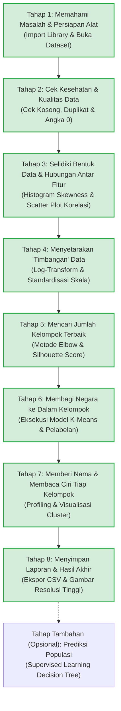

# Panduan Alur Kerja dan Dokumentasi Proyek UKK Data Science
## Pengelompokan (Clustering) Negara di Dunia Menggunakan K-Means Berdasarkan Profil Demografi

---

### Informasi Proyek
* **Judul Proyek:** Analisis Pengelompokan Negara Berdasarkan Profil Demografi Dunia Menggunakan Algoritma K-Means
* **Metodologi Standar:** CRISP-DM (*Cross-Industry Standard Process for Data Mining*)
* **Dataset:** `world_population.csv` (234 negara/wilayah, 17 variabel demografi)
* **File Utama Koding:** `analisis_kmeans.ipynb`
* **Folder Hasil (Output):** `output/`

---

## 1. Peta Jalan Pengerjaan (Roadmap Alur Kerja Standar)

Alur kerja dirancang berurutan dari hulu ke hilir menggunakan bahasa yang runtut dan mudah dipahami oleh siapapun (termasuk guru penguji atau orang awam):

---

## 2. Rangkuman Temuan Data (Penjelasan untuk Orang Awam)

Sebelum data diolah oleh kecerdasan buatan (*Machine Learning*), data telah diaudit secara teliti. Berikut adalah temuan dan artinya:

| Pemeriksaan | Hasil Temuan | Penjelasan Ramah Awam (Arti Temuan) |
| :--- | :---: | :--- |
| **Data Kosong (NaN / Null)** | **0 (Tidak Ada)** | **Sangat Baik.** Semua kotak data terisi lengkap 100%. Kita tidak perlu menebak-nebak atau membuang baris data. |
| **Data Duplikat** | **0 (Tidak Ada)** | **Sangat Baik.** Tidak ada nama negara atau wilayah yang tercatat ganda. |
| **Nilai 0 (Zero Values)** | **57 Negara** | Nilai 0 **hanya ada pada kolom `World Population Percentage`**. Pada populasi, luas wilayah, dan kepadatan **tidak ada angka 0**. 💡 *Artinya:* Negara-negara kecil (seperti Vatikan, Samoa, Andorra) memiliki penduduk di bawah 400.000 jiwa. Proporsinya terhadap penduduk bumi sangat kecil (< 0,005%), sehingga komputer membulatkannya menjadi `0.00%`. Ini **bukan error**, melainkan keterbatasan jumlah desimal. |
| **Bentuk Sebaran (*Skewness*)** | **Menceng Ekstrem (Right-Skewed > +6)** | **Data Tidak Merata.** Mayoritas negara berpenduduk dan berwilayah sedang/kecil, tetapi ada segelintir "raksasa" seperti China, India (populasi > 1,4 miliar), dan Rusia (wilayah amat luas). 💡 *Analogi:* Seperti menimbang semut dan gajah dalam satu timbangan yang sama. Jika langsung diolah, komputer hanya akan fokus pada gajah. Maka di Tahap 4 nanti, data wajib di-**transformasi logaritma** agar "setara". |
| **Hubungan Antar Data (*Korelasi*)** | **Korelasi Historis 1.0 (Identik)** | Populasi negara dari tahun 1970 sampai 2022 polanya nyaris kembar identik ($r \ge 0.98$). 💡 *Artinya:* Kita tidak perlu memasukkan semua tahun (1970, 1980, 1990, dst.) ke K-Means karena itu mengulang-ulang informasi yang sama (pemborosan). Cukup gunakan **Populasi 2022** bersama Luas Wilayah, Kepadatan, dan Laju Pertumbuhan. |

---

## 3. Checklist Tugas Pengerjaan (Urutan Baru yang Runtut)

> **Keterangan Status:**  
> `[x]` = **Selesai Dikerjakan & Diverifikasi** (Koding aktif dan output tampil di notebook)  
> `[ ]` = **Antrean Pengerjaan Selanjutnya** (Akan dieksekusi bertahap satu per satu)

---

### BAGIAN I: PENGENALAN & PEMERIKSAAN KESEHATAN DATA (DATA UNDERSTANDING)

#### Tahap 1: Persiapan Lingkungan & Pemuatan Data
- [x] **Task 1.1:** Menyusun dokumen latar belakang, rumusan masalah, dan tujuan penelitian CRISP-DM pada Markdown notebook.  
  *(Tujuan: Memberikan konteks ilmiah mengapa penelitian demografi dunia ini penting).*
- [x] **Task 1.2:** Mengimpor *library* inti (`numpy`, `pandas`, `matplotlib`, `seaborn`, `IPython.display`).  
  *(Tujuan: Menyiapkan seluruh alat hitung, manipulasi tabel, dan pembuat grafik).*
- [x] **Task 1.3:** Menentukan jalur folder dinamis (`BASE_DIR`, `DATA_PATH`, `OUTPUT_DIR`) menggunakan `pathlib.Path`.  
  *(Tujuan: Menjamin program bisa berjalan otomatis di komputer manapun tanpa error path).*
- [x] **Task 1.4:** Membaca file `world_population.csv` ke dalam variabel DataFrame `df`.  
  *(Tujuan: Memuat data ke memori kerja agar siap dianalisis).*

#### Tahap 2: Eksplorasi Dasar & Uji Kualitas Data
- [x] **Task 2.1:** Memeriksa dimensi data (`df.shape`, `len(df)`, `len(df.columns)`).  
  *(Hasil: Terkonfirmasi ada 234 baris negara dan 17 kolom fitur).*
- [x] **Task 2.2:** Melihat sampel 5 data teratas (`head`) dan tabel keseluruhan dengan `display()`.  
  *(Hasil: Mengetahui wujud fisik isi tabel data secara visual).*
- [x] **Task 2.3:** Menampilkan daftar seluruh nama kolom bertingkat nomor 01 s.d. 17.  
  *(Hasil: Mempermudah pembacaan seluruh atribut yang tersedia).*
- [x] **Task 2.4:** Memeriksa struktur teknis dan tipe data komputer (`df.info()`, `df.dtypes`).  
  *(Hasil: Memisahkan kolom teks `object` dengan kolom angka `int64` dan `float64`).*
- [x] **Task 2.5:** Menguji ada/tidaknya nilai kosong (`df.isnull().sum()`) dan baris kembar (`df.duplicated().sum()`).  
  *(Hasil: Terbukti 100% bersih tanpa missing value dan tanpa duplikat).*
- [x] **Task 2.6:** Menghitung ringkasan statistik matematika dasar (`df.describe()`).  
  *(Hasil: Mengetahui nilai terendah, nilai tertinggi, rata-rata, dan kuartil 25%, 50%, 75%).*
- [x] **Task 2.7:** Mengelompokkan negara berdasarkan benua (`unique()`, `nunique()`, dan `value_counts()`).  
  *(Hasil: Terdapat 6 benua terdaftar: Afrika 57, Asia 50, Eropa 50, Amerika Utara 40, Oseania 23, Amerika Selatan 14).*

#### Tahap 3: Menyelidiki Bentuk Data & Hubungan Antar Fitur (Visual EDA)
- [x] **Task 2.8:** Visualisasi bentuk sebaran data (Histogram & Boxplot) serta perhitungan angka *Skewness*.  
  *(Hasil: Grafik tersimpan di `output/eda_distribusi_sebelum_transformasi.png`. Terbukti data menceng tajam ke kanan akibat negara raksasa).*
- [x] **Task 2.9:** Analisis hubungan keterikatan antar data demografi (*Correlation Scatter Plot Dashboard*).  
  *(Hasil: Grafik 2x2 tersimpan di `output/eda_scatter_korelasi.png`. Terbukti secara visual titik sebaran populasi 2020 vs 2022 membentuk garis diagonal lurus sempurna r = 1.00 sebagai bukti redundansi, sedangkan Luas, Kepadatan, dan Laju Pertumbuhan saling mandiri).*

---

### BAGIAN II: PERSIAPAN DATA UNTUK KECERDASAN BUATAN (DATA PREPROCESSING)

#### Tahap 4: Merapikan & Menyetarakan Timbangan Data (*Feature Engineering*)
- [x] **Task 3.1: Pemilihan 4 Fitur Kunci:** Mengisolasi 4 atribut demografi independen terbaik untuk pengelompokan:
  1. `2022 Population` (Ukuran besaran populasi terkini)
  2. `Area (km²)` (Luas bentang teritorial wilayah)
  3. `Density (per km²)` (Tingkat kepadatan ruang hidup)
  4. `Growth Rate` (Dinamika laju pertumbuhan penduduk)
  *(Hasil: Fitur diisolasi ke variabel `df_features` ukuran 234 x 4, serta dibuatkan grafik visualisasi dashboard 2x2 Top 10 negara di `output/eda_top10_fitur_terpilih.png`).*
- [x] **Task 3.2: Transformasi Logaritma (`np.log1p`):** Mengubah skala nilai raksasa menjadi skala logaritmik agar sebaran data melandai menyerupai kurva lonceng normal.  
  *(Hasil: Skewness turun drastis ke rentang normal: Populasi +9.15 -> -0.60, Luas +6.08 -> -0.68, Kepadatan +8.95 -> +0.17).*
- [x] **Task 3.3: Visualisasi Sebelum vs Sesudah Log:** Menampilkan grafik perbandingan berdampingan (*Side-by-Side*) untuk membuktikan bahwa data yang tadinya menceng ekstrem sudah berhasil dinormalkan.  
  *(Hasil: Grafik komparasi 3x4 Histogram & Boxplot berhasil disimpan di `output/perbandingan_sebelum_sesudah_preprocessing.png`).*
- [x] **Task 3.4: Standardisasi Skala (`StandardScaler`):** Menyetarakan rata-rata $= 0$ dan standar deviasi $= 1$ pada seluruh fitur, agar satuan km² (ribuan/jutaan) tidak mendominasi rasio laju pertumbuhan (skala 1 koma sekian).  
  *(Hasil: Matriks `X_scaled` terbukti memiliki Mean = 0.0000 dan Std = 1.0021, visualisasi sebaran Z-Score tersimpan di `output/eda_standardized_features.png`).*

---

### BAGIAN III: PEMODELAN K-MEANS (CLUSTERING MODELING)

#### Tahap 5: Mencari Jumlah Kelompok Paling Ideal ($K$)
- [x] **Task 4.1: Uji Elbow Method (Inertia / WCSS):** Menghitung total variasi jarak dalam klaster untuk rentang $K = 1$ sampai $K = 10$.  
  *(Hasil: Baseline K=1 Inersia = 936.00. Penurunan inersia terbesar terjadi di K=2 (-40.96%), K=3 (-20.24%), dan K=4 (-16.22%). Mulai K=5 laju penurunan melandai di kisaran ~10%).*
- [x] **Task 4.2: Plotting Garis Elbow:** Membuat grafik garis untuk melihat titik patahan sudut siku (*elbow point*) penurunan inersia.  
  *(Hasil: Grafik 2 panel tersimpan di `output/model_elbow_method.png`. Terlihat jelas titik patahan siku pada K=3 dan K=4, di mana setelah K=4 laju penurunan inersia melandai drastis ke bawah 12%).*
- [x] **Task 4.3: Uji Silhouette Score:** Menguji seberapa tegas pemisahan antar klaster dan seberapa padat anggota di dalam masing-masing klaster ($K = 2$ s.d. $10$).  
  *(Hasil: Tabel `df_silhouette` menunjukkan K=4 menghasilkan Silhouette Score 0.3138, mengungguli K=3 yang hanya 0.3010, dan melampaui ambang batas kelayakan 0.30).*
- [x] **Task 4.4: Plotting Skor Silhouette:** Membuat grafik batang skor koefisien siluet untuk membandingkan keterpisahan klaster.  
  *(Hasil: Grafik batang beranotasi tersimpan di `output/model_silhouette_scores.png`. Menyoroti K=4 sebagai peraih skor tertinggi untuk kategori multi-klaster).*
- [x] **Task 4.5: Keputusan Final Nilai $K$:** Menetapkan jumlah kelompok terbaik ($K = 4$) dengan sintesis argumen matematis dan geografis yang komprehensif.  
  *(Hasil: Dashboard komparasi 1x2 tersimpan di `output/model_evaluasi_k_optimal.png`. Ditetapkan K=4 sebagai pilihan final optimal karena menghindari klaster singleton K=5 dan menghasilkan 4 profil demografi dunia yang seimbang).*

#### Tahap 6: Eksekusi Model K-Means & Pelabelan
- [x] **Task 5.1: Fitting Model K-Means:** Menjalankan algoritma `KMeans(n_clusters=4, init='k-means++', n_init=10, max_iter=300, random_state=42)`.  
  *(Hasil: Model konvergen sempurna dalam 11 iterasi dengan inersia akhir WCSS = 369.2780).*
- [x] **Task 5.2: Menempelkan Hasil ke Data:** Menambahkan kolom baru `Cluster` (berisi label 0, 1, 2, 3) ke dalam tabel data asli `df` dan `df_features`.  
  *(Hasil: Kolom `Cluster` sukses terpasang, dimensi data bertambah menjadi 234 x 18, 0 nilai kosong).*
- [x] **Task 5.3: Menghitung Persebaran Jumlah Negara:** Menghitung berapa banyak negara yang masuk ke tiap-tiap kelompok (`value_counts()`).  
  *(Hasil: Sebaran sangat merata: Klaster 0 = 54 negara (23.08%), Klaster 1 = 64 negara (27.35%), Klaster 2 = 71 negara (30.34%), Klaster 3 = 45 negara (19.23%). Visualisasi Bar & Donut chart tersimpan di `output/model_distribusi_klaster.png`).*
- [x] **Task 5.4: Titik Pusat Kelompok (Centroid):** Menghitung titik koordinat tengah (*centroid*) tiap kelompok dan mengembalikannya ke satuan fisik asli (*Inverse Transform* via `scaler.inverse_transform` dan `np.expm1`).  
  *(Hasil: Tabel koordinat fisik centroid terbentuk rapi, dan grafik Dashboard 2x2 Scatter Plot Sebaran Data & Titik Centroid dengan Marker X Merah tersimpan di `output/model_centroid_scatterplot.png`).*

---

### BAGIAN IV: MEMBACA HASIL & PELAPORAN (EVALUATION & REPORTING)

#### Tahap 7: Memberi Nama & Menganalisis Ciri Khas Tiap Kelompok
- [x] **Task 6.1: Profiling Karakteristik Kelompok:** Menghitung tabel rangkuman rata-rata (*mean*) dan median untuk masing-masing kelompok.  
  *(Hasil: Tabel statistik mean dan median terhitung rapi. Klaster 0 unggul di laju pertumbuhan 2.50%/thn, Klaster 1 unggul di kepadatan 1.338 jiwa/km², Klaster 2 unggul di populasi rata-rata 77,1 juta jiwa, dan Klaster 3 unggul di luas wilayah 1,39 juta km²).*
- [x] **Task 6.2: Pemberian Nama Bisnis Kelompok:** Memberi nama julukan yang bermakna untuk tiap kelompok dan menyematkan ke kolom `df['Cluster_Name']`:  
  * *Klaster 0: Negara Berkembang Tumbuh Pesat (54 negara - contoh: Pakistan, Nigeria, Ethiopia, Mesir)*
  * *Klaster 1: Negara-Kota Mikro & Kepulauan Padat (64 negara - contoh: Hong Kong, Singapura, Bahrain, Monako)*
  * *Klaster 2: Negara Megapopulasi Mapan (71 negara - contoh: China, India, AS, Indonesia, Brasil)*
  * *Klaster 3: Negara Teritorial Luas & Renggang (45 negara - contoh: Rusia, Argentina, Aljazair, Kanada, Australia)*
- [x] **Task 6.3: Visualisasi Sebaran Klaster 2D/3D:** Membuat matriks *Pairplot* warna-warni 4x4 dengan kurva diagonal KDE yang memperlihatkan pemisahan kelompok secara visual.  
  *(Hasil: Visualisasi komprehensif 300 DPI tersimpan di `output/model_sebaran_klaster_pairplot.png`).*
- [x] **Task 6.4: Analisis Asal Benua:** Melakukan tabulasi silang (*crosstab*) dan membuat *Stacked Bar Chart* komposisi benua di dalam masing-masing kelompok.  
  *(Hasil: Grafik komposisi benua 300 DPI tersimpan di `output/model_komposisi_benua_klaster.png`. Klaster 0 didominasi Afrika (33), Klaster 1 Amerika Utara/Karibia (23) & Oseania (16), Klaster 2 Eropa (28) & Asia (24), Klaster 3 Afrika (12) & Amerika Selatan (10)).*
- [x] **Task 6.5: Menampilkan Contoh Daftar Negara:** Tabel profil Top 5 negara terbesar perwakilan di tiap klaster untuk bahan presentasi sidang UKK.  
  *(Hasil: Tabel Top 5 perwakilan sukses tersaji rapi dengan format angka berpemisah ribuan).*
- [x] **Task 6.6: Dashboard Komparasi Perubahan Holistik:** Membuat Master Dashboard 2x2 yang membuktikan keunggulan K-Means terhadap pengelompokan tradisional benua, penurunan skewness, dan deviasi profil Z-Score.  
  *(Hasil: Master Dashboard 2x2 komparasi perubahan 300 DPI tersimpan di `output/model_perbandingan_perubahan_klastering.png`).*

#### Tahap 8: Menyimpan Laporan & Arsip Akhir
- [x] **Task 7.1:** Mengekspor tabel data lengkap hasil klastering ke file `output/world_population_clustered.csv`.  
  *(Hasil: File CSV berukuran 36.34 KB berhasil diekspor dengan 234 baris x 19 kolom, mencakup kolom 'Cluster' dan 'Cluster_Name').*
- [x] **Task 7.2:** Memastikan semua grafik tersimpan dengan kualitas tinggi (300 DPI) di folder `output/`.  
  *(Hasil: Total 15 file grafik PNG beresolusi tinggi 300 DPI terinventarisasi dan terverifikasi di folder `output/`).*
- [x] **Task 7.3:** Menyusun bab kesimpulan, interpretasi demografi, dan rekomendasi kebijakan pada notebook.  
  *(Hasil: Kesimpulan eksekutif, tabel evaluasi CRISP-DM, dan rekomendasi kebijakan strategis PBB/pemerintah dunia tersusun lengkap di notebook).*

---

### BAGIAN V: PENGEMBANGAN OPSIONAL (SUPERVISED LEARNING)
- [ ] **Task 8.1:** Menyiapkan data historis populasi 1970–2020 sebagai fitur ($X$) dan populasi 2022 sebagai target ($y$).
- [ ] **Task 8.2:** Membagi data latih dan data uji (`train_test_split` 80:20).
- [ ] **Task 8.3:** Melatih algoritma *Decision Tree Regressor*.
- [ ] **Task 8.4:** Menghitung akurasi prediksi menggunakan metrik *Mean Absolute Error (MAE)* dan *Root Mean Squared Error (RMSE)*.
